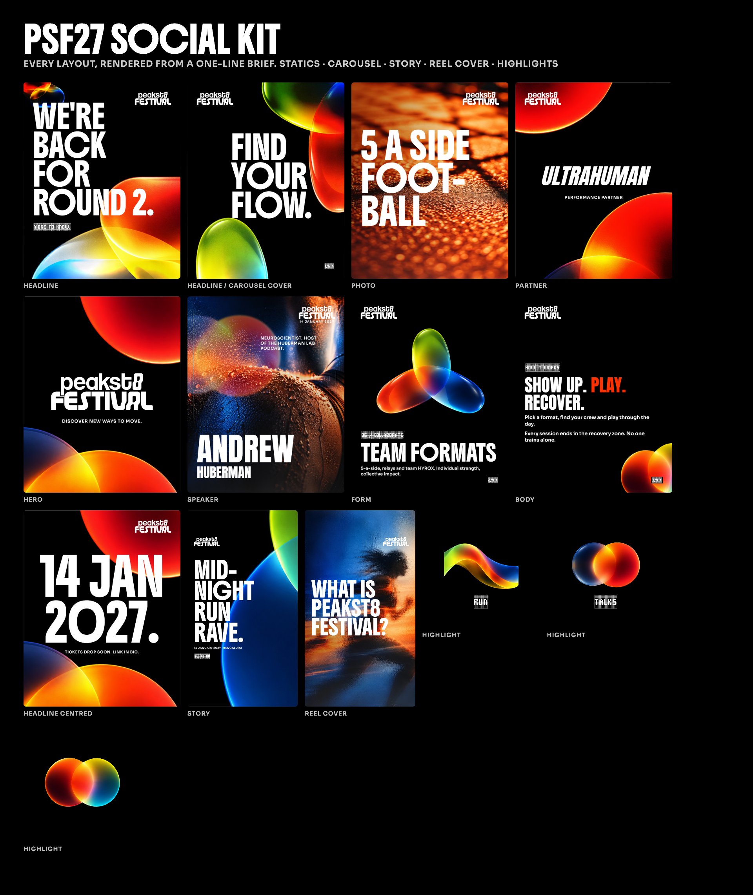

# peakst8 Festival 2027: workflows and skill files

Everything you need to make peakst8 Festival 2027 social posts with Claude.



## What's in here

Two kits that work together:

| | What it is | What you use it for |
|---|---|---|
| **PSF27 Social Kit** (`psf27-social/`) | Our festival brand kit turned into a skill: logo, colours, fonts, the 8 glass shapes, backgrounds, photo bank and the designer's own example posts. | Finished, on-brand **statics, carousels, stories, reel covers and highlight covers**. Free. |
| **Marketing Kit** (`marketing-kit/`) | 79 of the best marketing skills, compiled from GitHub, Higgsfield's skill files and the frameworks top AI teams use. | **Image-to-video, Reels, captions, hooks and copy, resizing, brand checks.** |

**The workflow:** write or paste the copy → the PSF27 kit designs the post → the Marketing Kit turns it into video or more formats if you need them.

**→ Prompt templates for every format: [WORKFLOWS.md](WORKFLOWS.md)**

## Install (once, about 5 minutes)

Use **Claude Code**, or the **Code** tab in the Claude desktop app. Posts are rendered on your computer, so you also need **Google Chrome** installed.

**Option A: three commands (recommended).** In Claude Code, run:

```
/plugin marketplace add arth6025/peakst8-mattermost
/plugin install psf27-social@peakst8
/plugin install marketing-kit@peakst8
```

Then restart Claude Code.

**Option B: upload the zips.** Download both files from [`downloads/`](downloads/). In Claude, go to **Customize → Plugins → Add → Upload plugin** and upload each one:
- [`psf27-social.zip`](downloads/psf27-social.zip)
- [`marketing-kit.zip`](downloads/marketing-kit.zip)

**First time you make a video:** Claude shows a **Connect** button for the media service. Sign in with your ShopOS email and pick the ShopOS workspace. You only do this once.

**Check it works:** start a new chat and type *"PSF post: FIND YOUR FLOW."* You should get a finished image back.

## Good to know

- **Free:** every PSF post, all copy and planning, and brand checks.
- **Costs credits:** images and videos from the Marketing Kit. Claude always shows the price and waits for your yes. The limit is 50 credits a day per person; ask Arvind for more.
- **Claude never invents facts.** Give it the real names, dates, venues and prices. The festival date in the kit is 14 January 2027.
- **Partner and speaker posts** need the partner's logo or a portrait photo from you.
- **Exact text in videos:** AI video can warp letters. If the headline must stay perfect, ask for "the code-motion route".
- **Want a video in the style of one you saw online?** See [Reverse engineer any video](../reverse-engineer/README.md).

## Troubleshooting

| Problem | Fix |
|---|---|
| Claude makes a generic post, not the festival look | Start your message with "PSF", or check both plugins are on under **Customize → Plugins**, then start a new chat. |
| "No Chrome/Chromium found" | Install Google Chrome, then try again. |
| "Not connected" when making a video | **Customize → Plugins → Marketing Kit → Connectors → Connect**, then pick the ShopOS workspace. |
| A run is blocked for spending | You hit your daily credit limit. Approve it, or ask Arvind. |
| An older marketing skill shows up instead | Retire the old ones: `mkdir -p ~/.claude/skills-retired && mv ~/.claude/skills/{ad-creative,image,video,social} ~/.claude/skills-retired/` |

## What's in this folder

```
README.md         ← you are here
WORKFLOWS.md      ← prompt templates: static, carousel, story, covers, image to video
overview.png      ← every PSF layout
downloads/        ← zips for the Claude app upload (Option B)
psf27-social/     ← PSF27 Social Kit plugin (brand assets + skill)
  skills/peakst8-festival-social/
    references/brand.md      ← brand rules: colours, fonts, glass shapes
    references/layouts.md    ← every layout and option
    assets/                  ← logos, fonts, backgrounds, glass shapes, photos
marketing-kit/    ← Marketing Kit plugin (79 skills, see CATALOG.md)
```

Questions? Ask Arvind.
